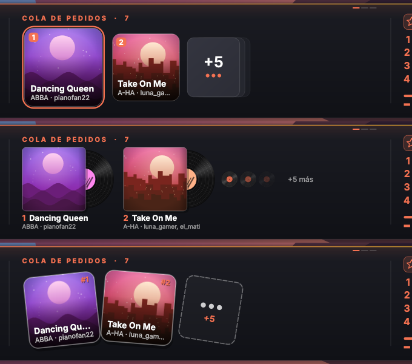
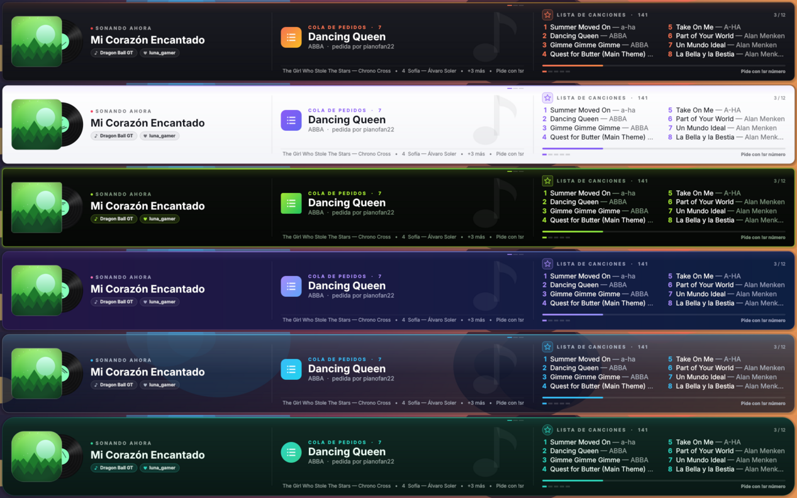
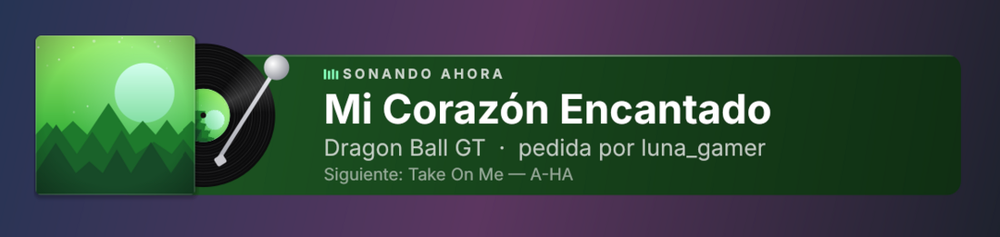
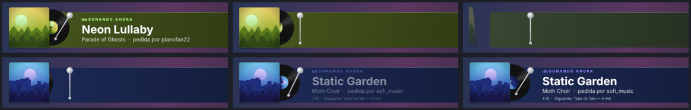

# AC Songlist · Instructivo de uso

Guía paso a paso para usar el plugin en un directo. Si aún no lo instalaste, mira la sección *Instalación* del [README](README.md).

## En resumen

1. Armas tu **biblioteca** de canciones dentro de OBS.
2. Tu público escribe **`!lista`** y **`!sr`** en el chat para pedir.
3. Tú pulsas **Tocar ahora** y la canción aparece en el stream.

No hace falta iniciar sesión en Twitch ni ningún token: solo el nombre de tu canal.

---

## 1. Abrir el panel

En OBS, menú superior **Paneles → AC Songlist**. Aparece una ventana flotante; arrástrala a un lado de OBS para dejarla acoplada.

Arriba del panel verás siempre dos cosas:

- **El estado del chat** (punto de color y texto).
- **El botón Pedidos abiertos / Pedidos cerrados**, para aceptar o no pedidos del chat.

## 2. Conectar tu canal

1. Pestaña **Ajustes**.
2. En **Canal de Twitch** escribe tu canal (vale `tu_canal` o el enlace completo).
3. Pulsa **Guardar y conectar**.

| Punto | Significado |
|---|---|
| 🟢 Verde, «conectado, leyendo pedidos» | Todo bien |
| 🟡 Amarillo, «Conectando…» | Espera unos segundos |
| 🔴 Rojo, «Sin conexión, reintentando…» | Revisa tu internet o el nombre del canal; reintenta solo |
| ⚪ Gris, «Chat sin configurar» | Falta escribir el canal |

## 3. Armar la biblioteca

Pestaña **Canciones**.

**Agregar una a una (lo más rápido):**
1. Escribe el título y pulsa **Enter**.
2. Escribe el artista y pulsa **Enter**.

La canción queda guardada con un **número fijo**. Ese número es el que usará tu público para pedirla.

**Importar muchas de golpe:** botón **CSV → Importar CSV…**. Acepta:
- Un CSV con columnas `título` y `artista` (y opcionalmente `categorías`).
- Un archivo de texto con una canción por línea: `Título - Artista`.
- El archivo que exporta StreamerSonglist.

Las repetidas no se duplican. Si borras **toda** la biblioteca y vuelves a importar, la numeración empieza otra vez en 1.

**Otras acciones:**
- **Buscar:** escribe en el buscador título, artista o número. No importan acentos ni mayúsculas.
- **Filtrar por categoría:** desplegable a la derecha del buscador.
- **Editar:** doble clic sobre la canción. Ahí puedes poner categorías (separadas por comas), una nota solo para ti, o **desactivarla** para que el público no pueda pedirla sin tener que borrarla.
- **Eliminar:** selecciona una o varias y pulsa **Eliminar**.
- **Copia de seguridad:** **CSV → Exportar CSV…**

## 4. Poner el overlay en tu escena

En tu escena: **Fuentes → + → AC Songlist**. Al crearla se abren sus propiedades; en **Qué mostrar** elige una de estas:

| Modo | Qué muestra |
|---|---|
| **Sonando ahora** | Tarjeta con la canción que estás tocando y quién la pidió. Si no suena nada, no se ve. |
| **Cola de pedidos** | Los próximos pedidos, en orden, con quién los hizo. |
| **Lista de canciones** | Tu biblioteca numerada, por páginas. |
| **Barra inferior** | Las tres cosas en una sola franja: sonando ahora (izquierda), cola (centro) y lista (derecha). |

Puedes agregar la fuente **varias veces**, una por cada modo, y colocar cada una donde quieras.

**Recomendado para la lista:** activa **«Mostrar solo cuando alguien escribe !lista»**. Así no ocupa pantalla todo el tiempo y aparece cuando la piden.

**Barra inferior.** Si eliges **Barra inferior (sonando · cola · lista)** no necesitas más fuentes: una sola dibuja una franja translúcida, tipo cristal, de borde a borde, pensada para el pie de la pantalla. Las partes van juntas, separadas solo por una línea fina:

- A la izquierda, **Sonando ahora**, con un disco que gira mientras suena la canción.
- En el centro, la **cola de pedidos**.
- A la derecha, la **lista de canciones**, que va pasando de página sola.

Cada parte se enciende o se apaga desde el panel AC Songlist, con las casillas **Barra: Sonando · Cola · Lista** (están debajo de «Sonando ahora»). Las que quedan encendidas se reparten todo el ancho; si apagas la cola, por ejemplo, la lista se pone al lado de «Sonando ahora».

**Diseño de la barra.** En las propiedades de la fuente eliges entre **Cristal de borde a borde** (el de arriba) y **Tarjeta**: una tarjeta con una línea de color arriba, la portada de la canción con su disco, etiquetas con el artista y quién la pidió, el siguiente pedido en grande con el resto de la cola pasando como una cinta, y una barra de progreso de las páginas de la lista.

En **Tema de la tarjeta** eliges el aspecto:

| Tema | Cómo se ve |
|---|---|
| **Medianoche** | Grafito oscuro, acento coral que pasa a ámbar, punto rojo y borde fino. |
| **Nieve** | Blanca, acento violeta a índigo y sombra más marcada. |
| **Neón** | Negra, borde verde lima que brilla y esquinas más rectas. |
| **Aurora** | Degradado de violeta a azul de lado a lado, punto rosa y esquinas más redondas. |
| **Cristal** | Azul noche translúcido con reflejo y acento celeste. |
| **Menta** | Verde profundo, esquinas tipo píldora, iconos redondos y etiquetas teñidas. |
| **Con mis colores** | Usa el color de acento, el fondo y el texto que elijas abajo. |

- **Opacidad del fondo de la tarjeta:** de 100 % (como el tema) a 0 % (sin fondo; quedan el texto, la portada y la línea de color). Funciona en todos los temas.
- **Letra de las instrucciones:** las instrucciones para pedir van debajo de la lista de canciones; en sus propiedades eliges su letra y tamaño. Si no caben, pasan como una cinta.
- **Diseño de la cola:** cómo se ve la cola de pedidos en la tarjeta.
  - **Cinta:** el siguiente pedido en grande y el resto pasando como una cinta.
  - **Galería de portadas:** los 2 siguientes como portadas con el título, el artista y quién lo pidió abajo; el siguiente, más grande y con un marco del color del tema. Si hay más, una pila de portadas con «+N •••».
  - **Vinilos asomando:** cada pedido es una funda con su disco asomando (gira despacio) y el título debajo; si hay más, discos pequeños que se desvanecen y «+N más».
  - **Abanico:** las 2 portadas un poco giradas, como cartas en la mano, con el título abajo; si hay más, una carta punteada con «••• +N».

En las propiedades de la fuente puedes cambiar el ancho y el alto (por defecto 1920 × 200; a más alto, más filas), el **ancho de «Sonando ahora»**, el color y la opacidad del cristal, el color de acento, las columnas de la lista y cada cuántos segundos cambia de página.

- **Opacidad del fondo:** al 100 % la franja es sólida; si la bajas (98, 95…) empieza a verse lo que hay detrás.
- **Letra más grande:** sube **Tamaño** en la tipografía de la fuente. Puede crecer hasta un 30 % del alto de la barra; si necesitas más, sube también el **Alto** (por ejemplo, 260).

«Sonando ahora» no desaparece al terminar una canción: el disco se detiene y se queda toda su información (título, artista y quién la pidió) con el rótulo **Última canción**, hasta que empiece la siguiente.

**Skins.** En las propiedades de la fuente, **Skin** permite elegir entre *Minimalista* y tres retro: *casete*, *equipo de sonido* y *vinilo*. Los retro tienen su propia paleta y solo toman tu **color de acento**; si no quieres movimiento, desmarca **Animar**.

**Tocadiscos.** Para «Sonando ahora» hay además el skin **Tocadiscos (cambia el disco en cada canción)**: la funda con la portada, el vinilo asomando y el brazo sobre el disco, en una tarjeta con los colores de la portada. Muestra el título, el artista, quién la pidió, cuánto lleva sonando y cuál es la siguiente de la cola.

- Al cambiar de canción se ve el cambio de disco: el brazo se levanta, el disco se guarda en la funda, la funda sale, entra la nueva, sale el disco y el brazo baja.
- Al terminar la canción el brazo se levanta, el disco se detiene y se queda la información con el rótulo **Última canción**.
- Las canciones no traen portada, así que el plugin dibuja una para cada una (siempre la misma para la misma canción).

**Cambiar el aspecto** (skin minimalista, en las propiedades de cada fuente): tipografía y tamaño, color del texto, color de acento, color y opacidad del fondo (0 = sin fondo), esquinas redondeadas, alineación, filas y columnas, y qué datos mostrar.

## 5. En directo

**Lo que escribe tu público:**

| Comando | Qué hace |
|---|---|
| `!lista` | Muestra la lista de canciones en pantalla |
| `!sr 12` | Pide la canción número 12 |
| `!sr dancing queen` | Pide por nombre (sirve título, artista o ambos) |
| `!quitar` | Retira su último pedido |

También funcionan `!pedir` y `!request` en lugar de `!sr`, y `!canciones` en lugar de `!lista`.

**Lo que haces tú**, en la pestaña **Cola**:

1. Cuando vayas a tocar el siguiente pedido, pulsa **▶ Siguiente**. La tarjeta aparece en el stream.
2. Para tocar otro pedido que no sea el primero, selecciónalo y pulsa **▶ Tocar ahora** (o doble clic).
3. Al terminar la canción:
   - **▶ Siguiente**: la da por tocada y empieza la próxima de la cola.
   - **✓ Terminar**: la da por tocada y oculta la tarjeta, sin empezar otra.
   - **Quitar**: la quita sin contarla como tocada.

**Tocar algo que nadie pidió:** pestaña **Canciones**, selecciona la canción y pulsa **▶ Tocar ahora**.

**Agregar un pedido tú mismo:** pestaña **Canciones**, selecciona y pulsa **+ A la cola**.

**Ordenar la cola:** selecciona un pedido y usa las flechas ▲ ▼, o **Quitar** para sacarlo.

**Pausar pedidos:** botón **Pedidos abiertos** arriba del panel. Al pulsarlo pasa a **Pedidos cerrados** y el chat no puede pedir hasta que lo vuelvas a abrir.

**Tus moderadores también pueden**, desde el chat: `!abrir`, `!cerrar`, `!tocada` (pasa a la siguiente) y `!saltar` (quita la actual).

> El plugin **no escribe en el chat**. El público ve el resultado de su pedido en el stream: en la cola y en la tarjeta.

## 6. Reglas de los pedidos

Pestaña **Ajustes → Reglas de los pedidos**:

- **Pedidos a la vez por persona:** cuántos puede tener en cola cada usuario (por defecto 2).
- **Máximo de canciones en cola:** tope total de la cola.
- **Segundos que se muestra la lista:** cuánto dura en pantalla tras un `!lista`.
- **Aceptar canciones que no están en la biblioteca:** si lo activas, un `!sr` con algo que no tienes entra igual a la cola con el texto que escribieron.

Si dos personas piden la misma canción, no se duplica: la segunda se suma al pedido y aparecen los dos nombres.

## 7. Página web pública

Para que tu público vea la lista completa fuera del stream:

1. En el panel AC Songlist, debajo de las casillas de la barra, pulsa **Publicar mi lista**.
2. Listo. La lista ya está en la web y el enlace quedó copiado: pégalo donde quieras compartirlo (el panel de tu canal, un comando de tu bot, tus redes).

Tu dirección es `https://ac-songlist.vercel.app/tu_canal`. Si todavía no habías escrito tu canal, el botón te lleva a **Ajustes** para que lo pongas.

Esa fila del panel queda siempre a la vista:

| Punto | Significado |
|---|---|
| 🟢 Verde, con tu enlace | Publicada. Pulsa el enlace para abrirla o **Copiar enlace** |
| 🟡 Amarillo, «Publicando…» | Espera unos segundos |
| 🔴 Rojo | No se pudo publicar; el texto dice por qué |
| ⚪ Gris, «sin publicar» | Pulsa **Publicar mi lista** |

La página tiene buscador y filtro por categoría, muestra la canción que suena y la cola, y **se actualiza sola**: cuando agregas una canción en OBS, aparece resaltada a los pocos segundos. Al tocar una canción se copia su comando (`!sr 12`).

- **La dirección también sale en el stream**, en el encabezado de la lista de canciones (y del panel de lista de la barra). Si no la quieres ahí, desmarca **Mostrar la dirección de la página web** en las propiedades de la fuente.
- Si usas un bot de chat (StreamElements, Nightbot…), crea un comando que responda con tu enlace; por ejemplo, que `!lista` conteste con la dirección mientras el plugin muestra la lista en pantalla.
- Solo se publican las canciones activas; tus notas privadas no salen del equipo.
- Para retirarla: **Ajustes → Página web pública** y desmarca **Publicar mi lista en la web**. Se borra de la web al momento.
- La página queda ligada a este equipo por una clave que el plugin guarda con tus datos. Si cambias de ordenador, lleva también el archivo de datos (ver *Preguntas frecuentes*).

## 8. Actualizaciones

El plugin se actualiza solo. Cuando sale una versión nueva, la descarga y la instala, y en el panel aparece:

> 🟢 Versión 1.8.0 instalada. Reinicia OBS para usarla.

La próxima vez que abras OBS ya estará la nueva. No se pierde nada: tus canciones, la cola y los ajustes se guardan aparte.

En **Ajustes → Actualizaciones** ves qué versión tienes y cuándo se buscó por última vez, y puedes:

- Pulsar **Buscar ahora** para comprobarlo en el momento.
- Desmarcar **Actualizar automáticamente**. Entonces el plugin solo avisa («Hay una versión nueva») y tú decides cuándo pulsar **Actualizar**.

También puedes actualizar desde el menú de OBS **Herramientas → Actualizar AC Songlist**: se abre una ventana que busca la última versión en el momento y, si hay una nueva, la instala con el botón **Actualizar**.

Si aparece un aviso en rojo («No se pudo instalar…»), pulsa **Descargar** e instálala a mano como la primera vez. Pasa, por ejemplo, si en Windows ejecutaste `instalar.bat` como administrador.

La primera vez que abres OBS con una versión nueva aparece una ventana con **lo nuevo de esa versión**. Sale una sola vez; para volver a verla: **Ajustes → Actualizaciones → Ver novedades**.

## 9. Atajos de teclado

En OBS: **Ajustes → Atajos**, busca «AC Songlist». Puedes asignar teclas a:

- Siguiente canción
- Terminar canción actual
- Abrir/cerrar pedidos
- Mostrar la lista en pantalla
- Barra: mostrar u ocultar la lista, «sonando ahora» o la cola

Útil para no soltar el instrumento: con un pedal o una tecla pasas a la siguiente.

## 10. Historial

Pestaña **Historial**: qué tocaste, cuándo y quién lo pidió. La biblioteca guarda además cuántas veces tocaste cada canción (columna **Veces**) y la última fecha (pasa el ratón por encima).

---

## Preguntas frecuentes

**No aparece el panel en el menú Paneles.**
El plugin no se cargó. En OBS: **Ayuda → Archivos de registro → Ver registro actual** y busca `ac-songlist`. En Mac, revisa que ejecutaste el segundo comando de `LEEME-MAC.txt` (el que quita el bloqueo de macOS).

**El punto está en rojo.**
Revisa el nombre del canal y tu conexión. El plugin reintenta solo cada pocos segundos.

**Alguien pidió y no entró a la cola.**
Comprueba que los pedidos estén abiertos, que esa persona no haya llegado a su límite, y que la canción exista y esté activa. Si escribió un nombre muy distinto al de tu biblioteca, no la encuentra.

**La tarjeta no sale en el stream.**
Solo se ve mientras hay una canción «sonando»: pulsa **Tocar ahora** o **Siguiente**. Revisa también que la fuente esté en la escena activa y visible (el ojo en la lista de fuentes).

**¿Dónde se guardan mis canciones?**
- Windows: `%APPDATA%\obs-studio\plugin_config\ac-songlist\songlist.json`
- macOS: `~/Library/Application Support/obs-studio/plugin_config/ac-songlist/songlist.json`
- Linux: `~/.config/obs-studio/plugin_config/ac-songlist/songlist.json`

Actualizar o reinstalar el plugin no las borra.

**¿Funciona con Kick o YouTube?**
No, por ahora solo lee el chat de Twitch.
