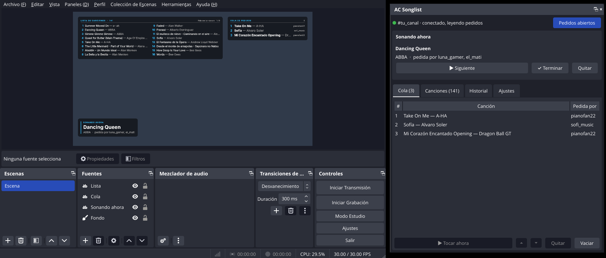
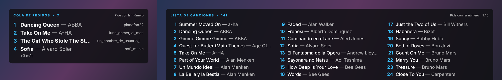
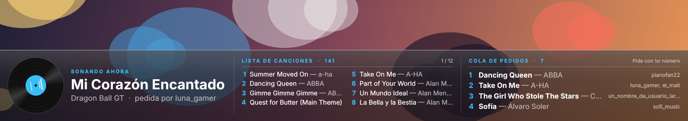
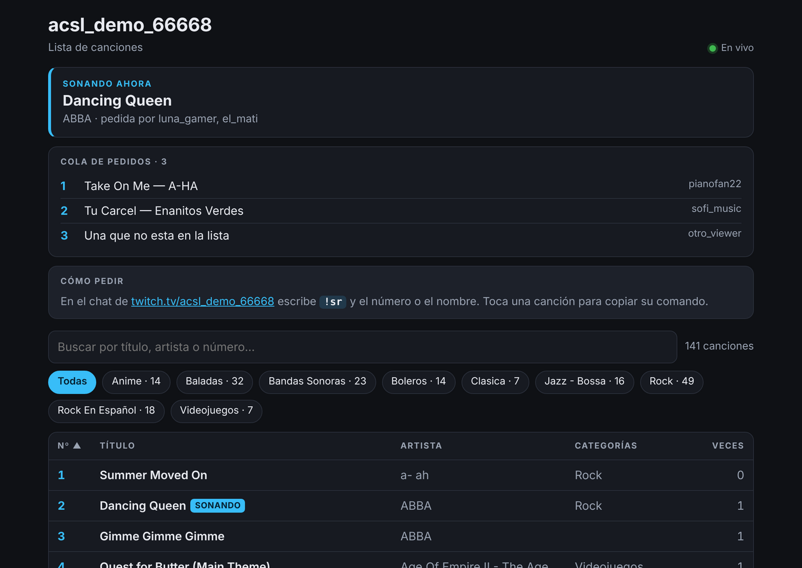

# AC Songlist · pedidos de canciones para OBS Studio

Plugin nativo de OBS (C++/Qt) para streamers que tocan en directo. Sin servicios externos:

1. **Tú armas la biblioteca** dentro de OBS, canción a canción o importando un CSV.
2. **Tu público elige**: escribe `!lista` para ver las canciones en pantalla y `!sr 12` o `!sr nombre` para pedir una.
3. **Cuando la tocas, se muestra** en el stream con una tarjeta minimalista de «Sonando ahora».




## Qué incluye

- **Panel acoplable** (menú *Paneles → AC Songlist*) con cuatro pestañas:
  - **Cola**: pedidos pendientes, quién los hizo, reordenar, quitar, *Tocar ahora*.
  - **Canciones**: alta rápida (título, Enter, artista, Enter), buscador sin acentos ni mayúsculas, categorías, editar, desactivar, importar y exportar CSV.
  - **Historial**: qué se tocó, cuándo y para quién.
  - **Ajustes**: canal de Twitch, límites de pedidos y página web pública.
- **Fuente de vídeo «AC Songlist»** para tus escenas, con cuatro modos:
  - *Sonando ahora*: la tarjeta de la canción actual, con fundido al cambiar.
  - *Cola de pedidos*: los siguientes pedidos y quién los pidió.
  - *Lista de canciones*: la biblioteca numerada, por páginas. Puede estar siempre visible o aparecer solo cuando alguien escribe `!lista`.
  - *Barra inferior*: los tres anteriores juntos en una sola fuente (ver más abajo).
- **Skins retro** además del minimalista: casete (con carretes que giran), equipo de sonido (display de puntos con ecualizador y marquesina) y vinilo (disco girando). Sirven para la tarjeta, la cola y la lista.
- **Tocadiscos** para «Sonando ahora»: funda con portada, vinilo y brazo, con los colores de la portada. En cada canción se ve el cambio de disco: el brazo se levanta, el disco se guarda, la funda sale, entra la nueva y el brazo baja. Las canciones no traen portada, así que el plugin genera una para cada una (siempre la misma).
- **Estilo neutro y configurable** desde las propiedades de la fuente: tipografía, tamaño, colores de texto, acento y fondo, opacidad (0 = sin fondo), esquinas, márgenes, alineación, encabezado, filas y columnas.
- **Barra inferior**: una sola franja de cristal de borde a borde con «Sonando ahora» (con un disco que gira mientras suena y se detiene al terminar, dejando la información de la última canción), la cola de pedidos y la lista de canciones. Cada parte se enciende y se apaga con una casilla del panel, sin crear más fuentes. Tiene dos diseños: *Cristal* y *Tarjeta* (portada con su disco y etiquetas, el siguiente pedido en grande con la cola pasando como una cinta, y progreso de páginas).
- **Página web pública** (opcional): tu lista en una página que puedes compartir, con buscador y filtro por categoría, que se actualiza sola cuando agregas canciones y muestra lo que suena y la cola.
- **Chat de Twitch** sin iniciar sesión ni tokens: solo escribes el nombre de tu canal. La conexión va cifrada y es de solo lectura.
- **Atajos de teclado** en *Ajustes → Atajos*: siguiente canción, terminar la actual, abrir/cerrar pedidos, mostrar la lista y encender/apagar cada panel de la barra.







## Instalación

Requiere **OBS Studio 30.2 o superior** (64 bits).

**Windows.** Descarga `AC-Songlist-Windows.zip` desde [Releases](https://github.com/alejox/ac-songlist/releases/latest), descomprime y ejecuta `instalar.bat` con OBS cerrado. A mano: copia la carpeta `ac-songlist` a `C:\ProgramData\obs-studio\plugins\`.

**macOS** (Apple Silicon e Intel). Descarga `AC-Songlist-macOS.tar.gz` desde el mismo sitio, descomprime y, con OBS cerrado, abre Terminal, escribe `bash ` y arrastra `instalar.command` a la ventana. El plugin no está firmado con una cuenta de desarrollador de Apple, por eso se instala desde Terminal; los detalles y la instalación a mano están en `LEEME-MAC.txt`.

**Linux.** Descarga `AC-Songlist-Linux.tar.gz` y copia la carpeta `ac-songlist` a `~/.config/obs-studio/plugins/`.

Después abre OBS y activa el panel en *Paneles → AC Songlist*.

### Actualizaciones

Solo hace falta instalarlo a mano la primera vez. Desde la **1.7.0** el plugin se actualiza solo:

1. Unos segundos después de abrir OBS (y luego cada 6 horas) pregunta a GitHub cuál es la última versión publicada.
2. Si hay una más nueva, descarga el paquete de tu sistema, comprueba su huella (sha256) contra la que publica GitHub y lo instala en la carpeta del plugin.
3. Como OBS tiene el plugin abierto, la versión nueva se usa **la próxima vez que abras OBS**. El panel lo avisa: «Versión X instalada. Reinicia OBS para usarla».

En *Ajustes → Actualizaciones* puedes desmarcar **Actualizar automáticamente**: entonces solo avisa y tú pulsas **Actualizar**. Si el plugin está instalado fuera de la carpeta de plugins de OBS, o Windows no le deja escribir en ella (por ejemplo, si `instalar.bat` se ejecutó como administrador), avisa de la versión nueva con un botón **Descargar**.

Después de cada actualización, al abrir OBS aparece una ventana con **lo nuevo de la versión** (sale una sola vez; se puede volver a ver en *Ajustes → Actualizaciones → Ver novedades*). El texto sale de [`data/novedades.txt`](data/novedades.txt), que también se usa en la página de cada versión en GitHub.

Cómo cambia los archivos sin romper nada: en Windows un `.dll` en uso no se puede sobrescribir pero sí renombrar, así que cada archivo viejo se aparta con otro nombre y el nuevo ocupa su lugar. En macOS y Linux se cambia la carpeta entera de una vez y la vieja se aparta fuera de la carpeta de plugins, para que OBS no la cargue como un segundo plugin. Si algo falla a mitad, se deshace. Lo apartado se borra en el siguiente arranque.

## Uso

**Guía completa paso a paso: [INSTRUCTIVO.md](INSTRUCTIVO.md)** · [en PDF](docs/AC-Songlist-Instructivo.pdf). Lo esencial:

1. **Biblioteca.** Pestaña *Canciones*: escribe título y artista y pulsa Enter. Cada canción recibe un número fijo, que es el que usa el público para pedirla.
2. **Chat.** Pestaña *Ajustes*: escribe tu canal de Twitch y pulsa *Guardar y conectar*.
3. **Overlay.** En tu escena, *Fuentes → + → AC Songlist*, y elige qué mostrar. Agrega la fuente tantas veces como quieras (por ejemplo, una para *Sonando ahora* y otra para la *Lista*).
4. **En directo.** Cuando vayas a tocar un pedido, pulsa **Siguiente** (o **Tocar ahora** sobre uno concreto). También puedes tocar una canción de la biblioteca sin que nadie la pida. Al acabar, **Terminar** o **Siguiente**.

### Comandos del chat

| Comando | Alias | Qué hace |
|---|---|---|
| `!sr <número o nombre>` | `!pedir`, `!request` | Pide una canción |
| `!lista` | `!canciones`, `!list` | Muestra la lista en pantalla |
| `!quitar` | `!wrongsong`, `!ws` | Retira tu último pedido |
| `!abrir` / `!cerrar` | `!sropen` / `!srclose` | Abre o cierra pedidos (streamer y mods) |
| `!tocada` | `!srnext` | Termina la actual y pasa a la siguiente (streamer y mods) |
| `!saltar` | `!srskip` | Quita la actual sin contarla (streamer y mods) |

El plugin no escribe en el chat: el resultado de cada pedido se ve en el stream (en la cola y en la tarjeta).

La búsqueda por nombre tolera acentos, mayúsculas, palabras sueltas y erratas pequeñas (`!sr sientist coldplay` encuentra *The Scientist*). Si dos personas piden la misma canción, la segunda se suma al pedido en vez de duplicarlo.

### Página web pública



En el panel, pulsa **Publicar mi lista** (está debajo de las casillas de la barra). Con ese clic la lista queda en la web y el enlace copiado: `https://ac-songlist.vercel.app/tu_canal`. La misma fila muestra después el estado, el enlace y el botón **Copiar enlace**. Mientras está publicada, la dirección sale también en el overlay, en el encabezado de la lista de canciones.

- La página muestra el catálogo completo, la canción que suena y la cola, y se pone al día sola.
- Al tocar una canción en la página se copia su comando (`!sr 12`) para pegarlo en el chat.
- Solo se publican las canciones **activas**. Las notas privadas no salen del equipo.
- La primera vez, el plugin genera una clave secreta que queda guardada en tu equipo: es la que demuestra que esa lista es tuya. Si reinstalas OBS en otro ordenador, copia también el archivo de datos (ver más abajo) o no podrás actualizar esa página.
- Para retirarla: **Ajustes → Página web pública** y desmarca **Publicar mi lista en la web**. Se borra de la web al momento.

El servicio y la página están en [`web/`](web/): un esquema de base de datos para Supabase ([`web/supabase/schema.sql`](web/supabase/schema.sql)) y una página estática sin paso de compilación, que Vercel publica en [ac-songlist.vercel.app](https://ac-songlist.vercel.app/) (el `vercel.json` de la raíz le indica que sirva solo esa carpeta).

### Importar canciones (CSV)

Botón **CSV → Importar**. Acepta:

- Un CSV con cabeceras `title`/`título`, `artist`/`artista` y, opcionalmente, `attributeNames`/`categorías`, `active`, `timesPlayed`, `lastPlayed`, `comment`. Es el formato que exporta **StreamerSonglist**, así que migrar desde ahí es exportar allí e importar aquí.
- Un CSV sin cabeceras: título, artista, categorías.
- Texto plano con una canción por línea: `Título - Artista`.

Las canciones repetidas (mismo título y artista) no se duplican.

## Dónde se guardan los datos

- Windows: `%APPDATA%\obs-studio\plugin_config\ac-songlist\songlist.json`
- macOS: `~/Library/Application Support/obs-studio/plugin_config/ac-songlist/songlist.json`
- Linux: `~/.config/obs-studio/plugin_config/ac-songlist/songlist.json`

Biblioteca, cola, historial y ajustes van en ese archivo. Reinstalar o actualizar el plugin no lo toca.

## Compilar

```bash
sudo apt-get install cmake ninja-build g++ libobs-dev qt6-base-dev
```

```bash
cmake -S . -B build -G Ninja -DACSL_BUILD_TESTS=ON
```

```bash
cmake --build build
```

```bash
QT_QPA_PLATFORM=offscreen ./build/acsl-tests
```

En Windows y macOS lo compila [el flujo de GitHub Actions](.github/workflows/build.yml), que arma un SDK mínimo de OBS (cabeceras de la versión 30.2.3 y, para enlazar, los binarios de la versión oficial) y usa Qt 6.6. El de macOS es universal (arm64 + x86_64).

### Estructura

| Carpeta | Contenido |
|---|---|
| `src/core/` | Biblioteca, cola, búsqueda, CSV y comandos de chat. Solo QtCore, con pruebas. |
| `src/chat/` | Cliente del chat de Twitch (IRC cifrado). En Windows y macOS usa la red del sistema (WinHTTP / Network.framework), porque el Qt que trae OBS ahí no incluye TLS. |
| `src/overlay/` | Dibujado del overlay y la fuente de vídeo de OBS. |
| `src/ui/` | Panel acoplable. |
| `src/net/`, `src/web/` | Cliente HTTPS por sistema operativo y publicación del catálogo en la web. |
| `src/update/` | Actualizaciones automáticas desde las versiones publicadas en GitHub. |
| `web/` | Página web pública y esquema de la base de datos. |
| `tests/` | Pruebas del núcleo (con un servidor de chat simulado), prueba de conexión real con Twitch y generador de imágenes de muestra. |

## Límites conocidos

- Solo lee el chat de **Twitch** (no Kick ni YouTube), y no escribe en él.
- Probado dentro de OBS 30 en Linux. Las versiones de Windows y macOS se compilan y pasan las pruebas del núcleo en GitHub Actions, pero no se han ejecutado dentro de OBS en esos sistemas antes de publicarlas aquí: si algo falla al cargarlo, el registro de OBS (*Ayuda → Archivos de registro*) lo dirá en las líneas `[ac-songlist]`.
